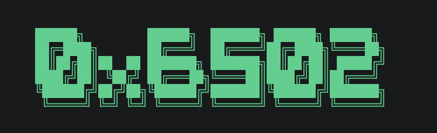
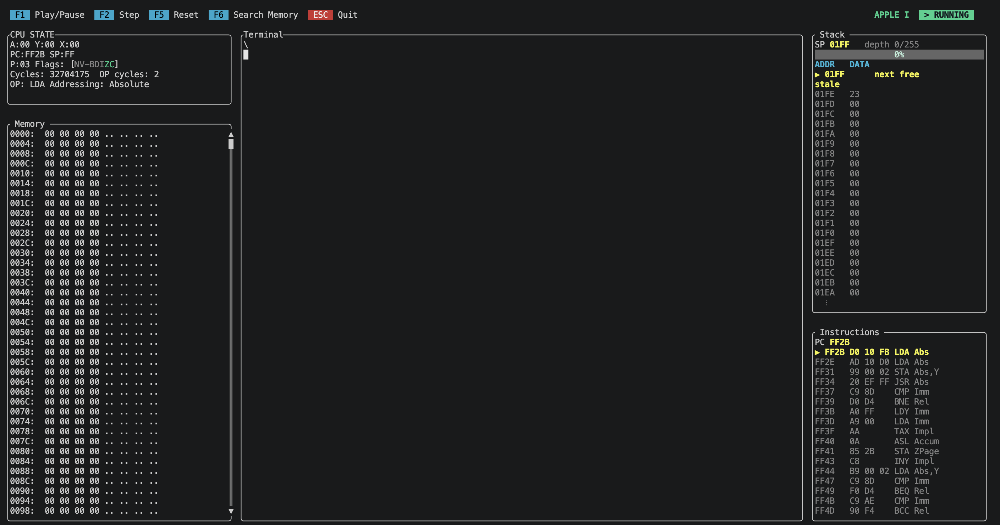

# 0x6502

A MOS/Synertek 6502 retro-computer lab and terminal emulator built in Rust.

---

## Overview

0x6502 is an emulator for the MOS/Synertek 6502 processor, the central processing unit used in legendary retro computers such as the Apple I, Apple II, and Commodore 64. 

The project focuses on retro computer architectures rather than video game consoles like the NES. Its architecture uses a decoupled system bus that separates the CPU from memory and I/O devices, allowing quick switching between different target machines and custom hardware configurations.

### Key Features

* **Modular System Bus:** Clear abstraction separating CPU, RAM/ROM, and I/O peripherals.
* **TUI Inspection Panels:** Real-time monitoring of registers, status flags, clock cycles, stack contents, CPU Instructions and memory mapping. Using ratatui.
* **Target Architectures:** Extensible setup to support various 6502-based microcomputer designs.

---

## Supported Systems

- [x] **Apple I**
- [ ] **Apple II** *(Planned)*
- [ ] **Commodore 64** *(Planned)*
- [ ] **Ben Eater's Breadboard 6502 PC** *(Planned)*

---

## Installation

Install the binary directly using `cargo`:

```bash
cargo install x6502
```
## Keybindings

| Key | Action |
| :--- | :--- |
| `F1` | Play / Pause execution |
| `F2` | Step single CPU cycle |
| `F5` | System reset |
| `F6` | Jump to memory address in memory panel |
| `PageUp` / `PageDown` | Scroll memory panel |
| `Esc` | Quit application |

## Contributing
Contributions are welcome! Please feel free to submit a Pull Request.

## License
This project is licensed under the GNU General Public License v3.0 - see the [LICENSE](LICENSE) file for details.

## Support
If you encounter issues or have questions, please [open an issue](https://github.com/ThePangel/RustifyDL/issues).

---
Built with Rust 🦀 and 💖 by thepangel ^_____^